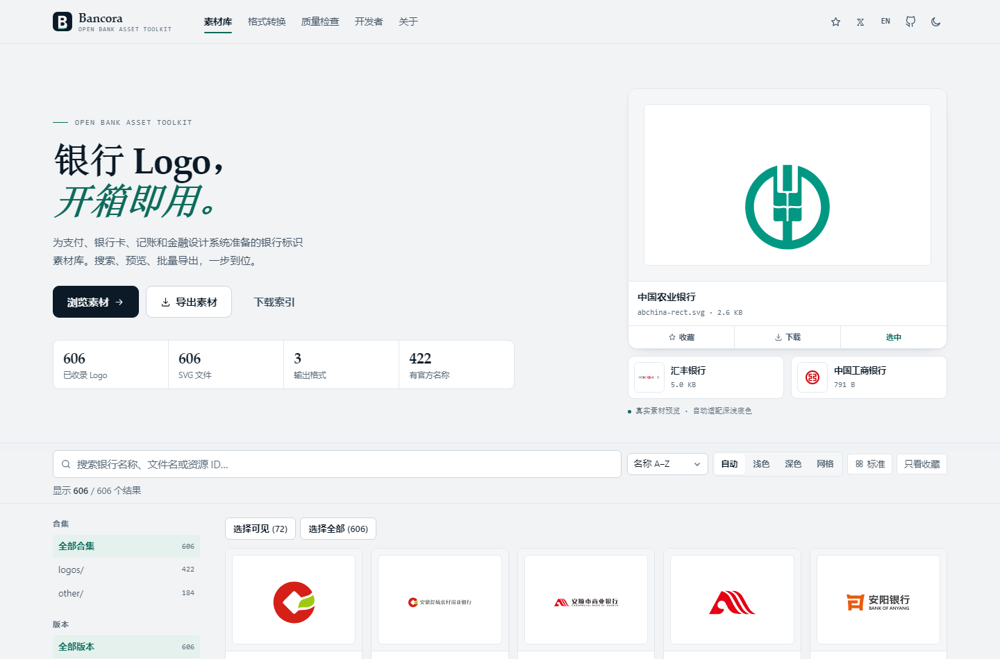
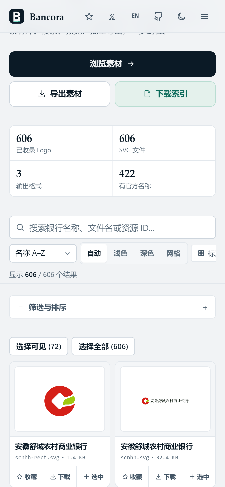
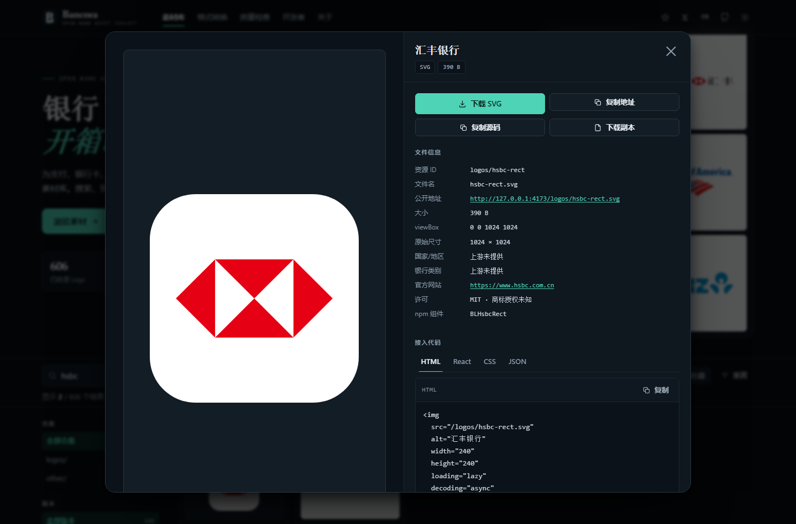
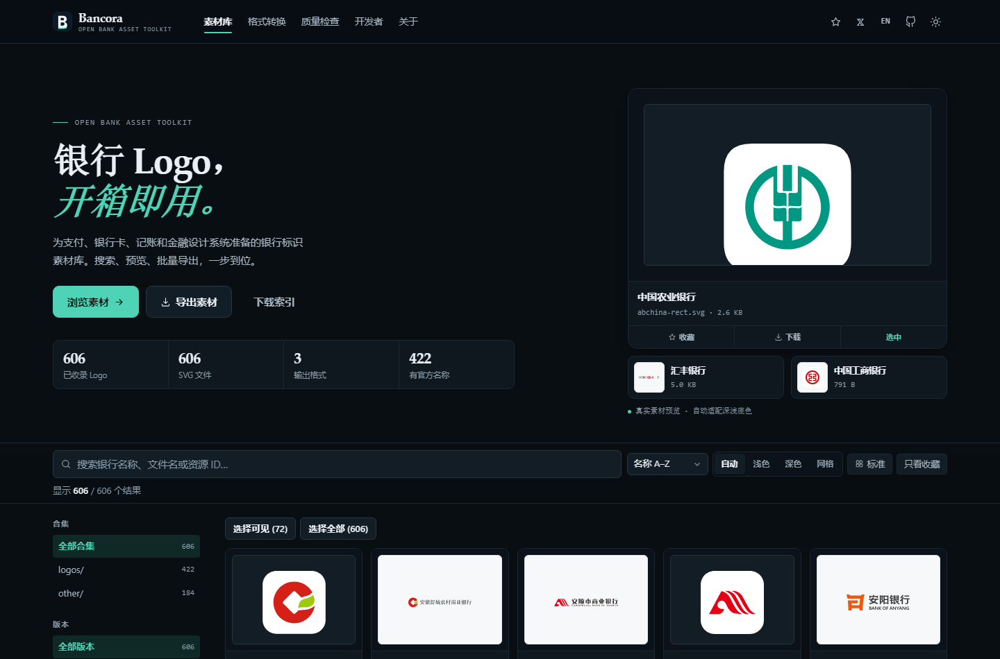
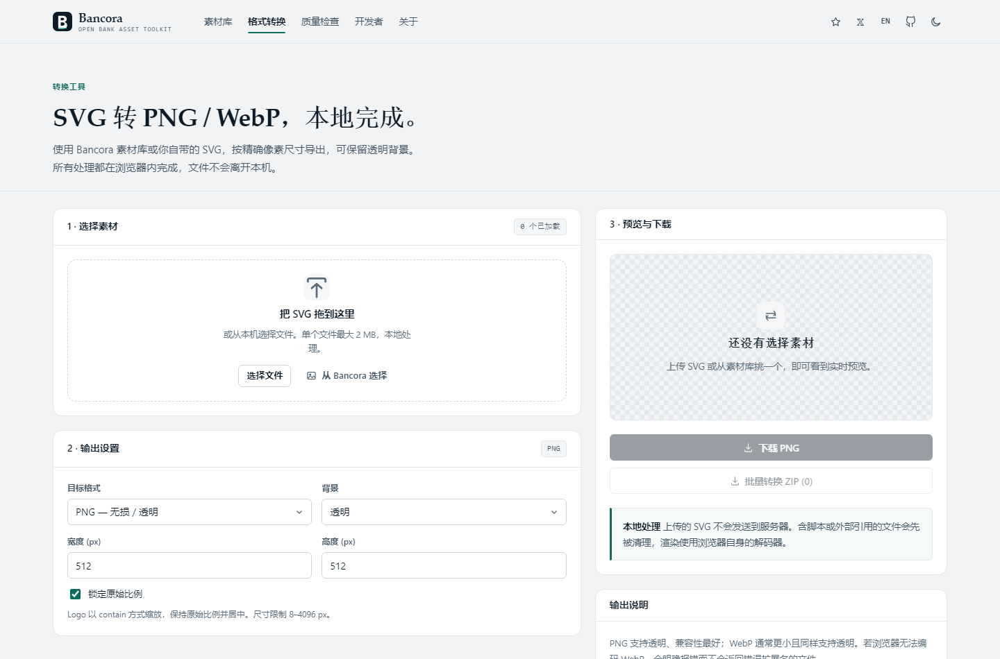

<div align="center">


# Bancora

**Every Bank. Every Logo. One Toolkit.**

开放银行 Logo 素材工具箱 · Open Bank Asset Toolkit

[](https://github.com/iiiiiiiiiiiiiKK/bancora)
[](LICENSE)
[](#测试)
[](#测试)
[](https://x.com/0xkillcoin)
[](https://github.com/iiiiiiiiiiiiiKK/bancora)

[在线站点](https://iiiiiiiiiiiiiKK.github.io/bancora/) · [功能](#功能) · [快速开始](#快速开始) · [文档](#文档) · [作者](https://x.com/0xkillcoin)

</div>

---

Bancora 是一个**纯静态**的银行品牌素材工具站，基于 MIT 许可的
[icongo/bank-logos](https://github.com/icongo/bank-logos) 合集构建。它把"找一个银行 Logo → 确认文件能用 → 导出合适尺寸 → 接进项目"
这条重复劳动压缩成几秒钟的操作。

- 🔍 **606 个真实 SVG**，本地索引秒级搜索
- 📦 **批量导出 ZIP**，浏览器内打包，附带 `manifest.json`
- 🎨 **SVG → PNG / WebP**，精确像素、透明背景
- 🛡 **结构质量检查**，脚本、外部引用、重复文件一目了然
- 🌗 **深浅色自适应底板**，深色模式下 Logo 也不会"消失"
- 🀄 **中文界面**，右上角一键切换英文
- 🚫 **无账号、无数据库、无上传、无追踪**

## 功能

| 能力 | 位置 | 说明 |
| --- | --- | --- |
| 浏览与搜索 | `/` | 606 个素材，支持名称、别名、文件名、资源 ID，大小写与标点容错 |
| 筛选与排序 | `/` | 合集、版本、收藏、结构状态；名称、文件名、文件大小五种排序 |
| 素材详情 | `/` | 元数据、三种预览底板、HTML / React / CSS / JSON 代码一键复制 |
| 单张下载 | `/` | 下载真实文件，与仓库中的原文件逐字节一致 |
| 收藏 | `/` | 存在本机 `localStorage`，按稳定 ID 记录，刷新不丢 |
| 批量导出 | `/` | 多选、全选筛选结果、ZIP 打包、进度、取消 |
| 格式转换 | `/convert` | PNG / WebP、自定义尺寸、锁定比例、透明或纯色背景、批量导出 |
| 质量检查 | `/inspector` | XML 结构、viewBox、空文件、重复内容、外部引用、脚本检测，导出 JSON / CSV |
| 数据下载 | `/data/*.json` | 自动生成的索引与审计报告 |
| 开发者文档 | `/developer` | 数据结构、代码示例、URL 规则、`@icongo/bl` 兼容说明 |

## 截图

<div align="center">
  
</div>

<div align="center">
  
  &nbsp;
  
</div>

<div align="center">
  
  &nbsp;
  
</div>

## 数据

| 项目 | 数值 |
| --- | --- |
| 素材总数 | **606** 个 SVG |
| `logos/` | 422 |
| `other/` | 184 |
| 总大小 | 4.95 MB |
| 有上游文档的名称 | 422（69.6%） |
| 暂定名（来自文件名） | 184（30.4%） |
| 通过结构检查 | 606（0 错误 / 0 警告） |
| 完全相同的文件组 | 3 组（仅报告，未删除） |

> 国家、银行类别、SWIFT/BIC 和商标授权**上游没有提供**，因此数据集中**不包含**这些字段，Bancora 也不会根据图形猜测。
> 详见 [docs/ASSET_AUDIT.md](docs/ASSET_AUDIT.md)。

## 快速开始

```bash
git clone https://github.com/iiiiiiiiiiiiiKK/bancora.git
cd bancora
npm install
npm run dev          # http://localhost:5173
```

生产构建：

```bash
npm run build        # 类型检查 + 构建 → dist/
npm run preview      # http://localhost:4173
```

## 技术栈

| 层 | 选择 |
| --- | --- |
| 框架 | React 18 + TypeScript（strict） |
| 构建 | Vite 5 |
| 样式 | 原生 CSS，设计 token 驱动，无 UI 框架 |
| 打包 | JSZip（浏览器端） |
| 转换 | 浏览器 SVG 解码 + Canvas |
| 测试 | Vitest（单元/数据）+ playwright-core（真实 Chrome） |
| 部署 | 静态托管：GitHub Pages / Cloudflare Pages / Vercel / Netlify |

### 架构

```
bancora/
├─ public/
│  ├─ logos/           422 个 SVG（主合集，保持上游原样）
│  ├─ other/           184 个 SVG（补充合集）
│  ├─ data/
│  │  ├─ assets.json   生成的完整索引
│  │  └─ audit.json    重复、冲突与质量汇总
│  └─ brand/           标识、字标、分享图
├─ scripts/
│  ├─ scan-assets.mjs      扫描 + 结构分析 + 墨色分析 → 索引与审计
│  ├─ validate-assets.mjs  校验索引与磁盘文件的一致性
│  ├─ generate-brand.mjs   从真实素材渲染分享图
│  ├─ generate-seo.mjs     生成 sitemap / robots
│  └─ postbuild.mjs        写入各平台托管配置
├─ shared/
│  └─ svg-analysis.mjs     结构检查与墨色分析（脚本与浏览器共用）
├─ src/
│  ├─ components/      卡片、详情、导出篮、页头页脚、图标
│  ├─ pages/           素材库、转换、检查、文档、关于、404
│  ├─ hooks/           数据加载、收藏、选择、偏好、检查
│  ├─ lib/             搜索、路径与代码片段、ZIP、转换、底板、i18n
│  ├─ styles/          设计 token 与应用样式（深色完整适配）
│  └─ types/           数据契约
└─ docs/               审计、数据结构、开发、测试、安全、改版说明
```

数据是单向的：**磁盘文件 → 扫描脚本 → JSON 索引 → 界面**。界面从不修改元数据；
`npm run assets:validate` 会在两者不一致时直接失败。

## 深色模式下的 Logo 可见性

有些 Logo 本身是黑色或纯白，直接放在同色背景上会"消失"。Bancora 的做法是：

1. 构建索引时解析每个 SVG 声明的 `fill` 颜色，计算相对亮度；
2. 归类为 `dark` / `light` / `mixed`（当前：290 / 14 / 302）；
3. 预览底板按墨色自动匹配 —— 深色 Logo 用浅底板，白色 Logo 用深底板，彩色 Logo 跟随主题；
4. 可手动切换 自动 / 浅色 / 深色 / 网格，偏好本地保存；
5. **原始 SVG 文件一个字节都没有改动。**

实测 72 张卡片：深色主题 + 自动底板，**0 个不可见**；旧行为（强制深底板）会有 2 个以上完全看不见。

## 测试

```bash
npm run typecheck        # TypeScript strict
npm run assets:validate  # 10 项数据不变量，606 个资源
npm run test             # 73 项单元 / 数据测试
npm run test:e2e         # 31 项真实浏览器检查（需 Chrome + preview）
```

端到端检查不只验证"按钮有反应"：下载文件与仓库原文件**逐字节比对**、PNG 读取 IHDR 校验尺寸、
WebP 校验 RIFF/WEBP 魔数、ZIP 解压后比对内部 SVG、剪贴板内容读回校验、55 组视口布局扫描。

| 检查 | 结果 |
| --- | --- |
| 类型检查 | 通过 |
| 单元 / 数据测试 | 9 文件 73 项 |
| 真实浏览器检查 | 31 / 31 |
| 响应式矩阵 | 11 宽度 × 5 页面 = 55 组，0 溢出、0 换行、0 过小点击区 |

## 部署

### GitHub Pages（自动）

推送到 `main` 后，`.github/workflows/deploy.yml` 会自动：

1. 安装依赖 → 校验索引 → 跑测试；
2. 以 `BANCORA_BASE=/bancora/` 构建，路由切换为 hash 模式（Pages 无法重写路径）；
3. 上传 `dist/` 并以 GitHub Pages 发布。

首次使用需在仓库 **Settings → Pages → Source** 选择 **GitHub Actions**。

### Cloudflare Pages

| 配置项 | 值 |
| --- | --- |
| Framework preset | Vite |
| Build command | `npm run build` |
| Output directory | `dist` |
| Node version | 20 或以上 |

`dist/_redirects` 已内置 SPA 回退，无需额外配置。

### Vercel / Netlify

直接导入仓库即可，`vercel.json` 与 `netlify.toml` 已写入 `dist/`。

### 其他静态托管

```bash
npm run build
# 将 dist/ 上传；确保未知路径回退到 index.html
```

## 数据字段

| 字段 | 类型 | 说明 |
| --- | --- | --- |
| `id` | string | 稳定标识，如 `logos/abchina-rect` |
| `name` | string | 上游文档提供的中文名称 |
| `nameStatus` | `documented \| tentative` | 暂定名表示来自文件名，界面会标注 |
| `filename` / `relativePath` / `publicPath` | string | 文件名与路径 |
| `collection` | `logos \| other` | 所属合集 |
| `variant` | `plain \| rect \| badge` | 版本命名约定 |
| `format` / `fileSize` / `sha256` | string / number | 文件事实 |
| `viewBox` / `width` / `height` | string \| number | 尺寸信息 |
| `country` / `category` | `null` | 上游未提供，刻意留空 |
| `website` | string \| null | 上游 README 链接的官网 |
| `license` | object | MIT；商标授权固定 `unknown` |
| `ink` | object | 墨色估算，仅用于预览底板 |
| `quality` | object | 结构状态与问题代码 |

完整说明见 [docs/DATA_SCHEMA.md](docs/DATA_SCHEMA.md)。

## 贡献

1. 把 SVG 放进 `public/logos/` 或 `public/other/`，沿用上游命名（`slug.svg` / `slug-rect.svg`）；
2. 运行 `npm run assets:scan && npm run assets:validate && npm run test`；
3. 在 `/inspector` 确认新文件没有结构错误；
4. 提交 PR，并说明素材来源与许可依据。请不要添加无法引用的国家、类别或商标声明。

## 许可与商标

代码与 SVG 合集以 **MIT** 许可发布，Copyright © 2022 IconGo。

> 银行 Logo 与商标归各自权利人所有。Bancora 是独立的素材工具站，与所列机构无隶属、赞助或背书关系。
> MIT 覆盖的是文件本身，不覆盖其中出现的银行商标；商业使用前请核实来源、品牌规范与适用条款。
> 通过结构检查不代表获得商标使用许可。

## 作者

**𝕏 [@0xkillcoin](https://x.com/0xkillcoin)**

如果这个项目对你有帮助，欢迎在 X 上关注作者，或给仓库点一个 ⭐。

<div align="center">
<sub>Built with care for fintech developers and designers.</sub>
</div>
